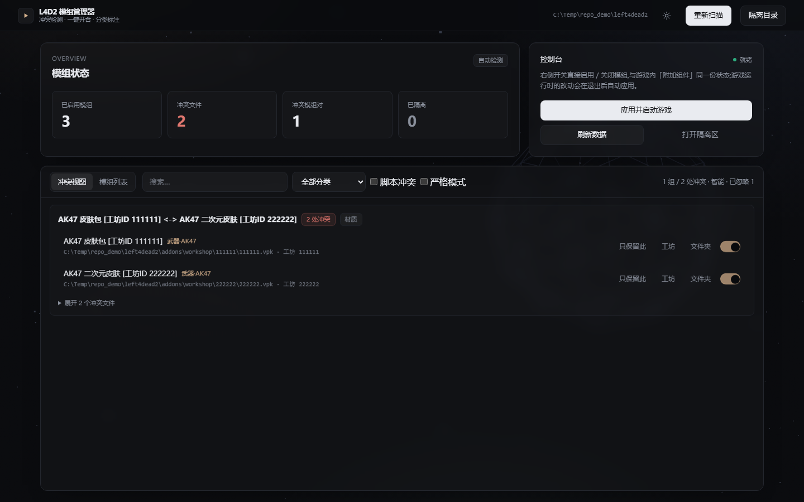
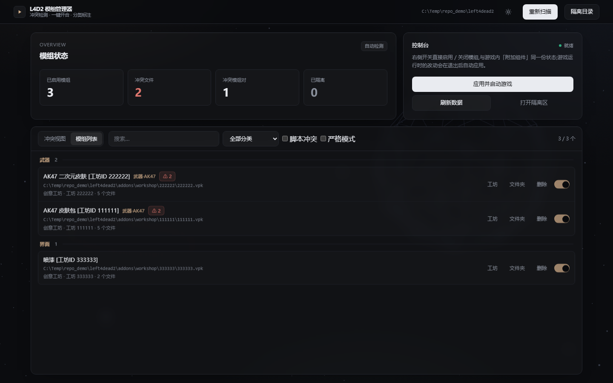

# L4D2 模组管理器

一个用于《Left 4 Dead 2(求生之路 2)》的**本地模组冲突检测与管理工具**。
扫描 `left4dead2/addons` 下的创意工坊/手动/松散模组,解析 VPK 内部路径,
找出多个模组覆盖同一文件造成的冲突,并提供启用/关闭、隔离、删除等管理能力。



> 纯本地运行:只监听 `127.0.0.1`,不联网、不上传任何数据。

## 功能

- **模组发现**:创意工坊 VPK(扁平 `<id>.vpk` / 子目录 `<id>/<id>.vpk`)、手动 VPK、松散文件夹;
- **冲突检测**:
  - **智能模式**(默认):按内容(CRC32 + 长度)忽略完全相同的共享文件,并默认隐藏 `scripts/` 类,减少误报;
  - **严格模式**:按文件路径重叠判定,包含脚本与相同内容,**接近游戏本体的“附加组件冲突”提示**;
- **冲突视图**:按模组对聚合,显示冲突数量,可展开具体文件;支持「只保留此」;
- **分类与作用对象**:自动识别武器 / 角色 / 声音 / 界面 / 地图 / 特效等,并标注目标(如「武器·AK47」「角色·佐伊」「特感·坦克」);
- **启用/关闭**:直接管理游戏自己的 `left4dead2/addonlist.txt`(与游戏内「附加组件」同一份状态),**不移动文件**;
- **安全写入**:游戏运行时不写 `addonlist.txt`,退出后由后台守护写回,避免与游戏抢写;
- **一键应用并启动**:先写目标状态,再通过 Steam 启动游戏;
- **自动定位游戏**:Steam 注册表、库文件、appmanifest、各盘符、运行中进程;
- **界面**:Tailwind + 原生 JS + Three.js 氛围背景,WebView2 原生窗口,浅色/深色主题。



## 冲突判定与游戏本体的关系

游戏本体的冲突提示在界面层(`#L4D360UI_ADDON_CONFLICT_WARNING`),
切换附加组件时执行 `update_addon_paths; mission_reload`,
判定依据是**已启用模组的文件路径重叠**,并不比较文件内容/CRC。
因此脚本、内容相同的共享文件也会被游戏算作冲突。

本工具提供两种模式:

| 模式 | 判定方式 | 适用 |
|---|---|---|
| 智能 | 路径重叠 + CRC/长度不同;忽略脚本 | 日常排查,误报少 |
| 严格 | 仅路径重叠(含脚本/相同内容) | 对齐游戏本体提示 |

详细中文说明见 [docs/USAGE.zh-CN.md](docs/USAGE.zh-CN.md)。

## 快速开始

### 方式一:下载 exe(推荐)

从 **Releases**(或 GitHub Actions 的 Artifacts)下载 `L4D2ModManager.exe`,
双击运行即可,无需安装 Python。

- Windows 10/11(64 位);
- 首次运行如遇 SmartScreen:更多信息 → 仍要运行;
- exe 需要系统自带 **WebView2**(Windows 10/11 一般都有),缺失时会回退浏览器。

### 方式二:源码运行

需要 Python 3.11+。

```bash
pip install -r requirements.txt
python src/l4d2_webapp.py          # WebView2 原生窗口
# 或
python src/l4d2_conflict_checker.py --serve   # 本地网页版
```

命令行检查:

```bash
python src/l4d2_conflict_checker.py
python src/l4d2_conflict_checker.py --strict          # 严格模式
python src/l4d2_conflict_checker.py --game-dir "E:\SteamLibrary\steamapps\common\Left 4 Dead 2"
```

## 构建 exe

Windows 下:

```powershell
powershell -ExecutionPolicy Bypass -File scripts/build_exe.ps1
```

产物:`dist/L4D2ModManager.exe`。

GitHub Actions 也会在 Windows 上自动构建并上传 Artifact
(`.github/workflows/build-windows.yml`)。

## 安全与边界

- 只在 `left4dead2/addons`、`addons_disabled` 内移动/删除;路径校验会拒绝重解析点/符号链接;
- 删除前有二次确认;隔离可逆;
- 本地服务需要启动时生成的令牌,并校验 Host/Origin/JSON,降低跨源盲写风险;
- 不注入、不修改游戏本体 `pak01_*.vpk`;
- **游戏运行中不会写 `addonlist.txt`**(游戏会覆盖),只记录目标状态,退出后写回;
- 真正的“资源级实时热切换”只有游戏内菜单能安全完成,本工具不强制卸载引擎内容。

## 已知限制

- 创意工坊目录中**未列入 `addonlist.txt` 的 VPK 会被游戏默认启用**;积累过多旧 VPK 会拖慢加载,可在管理器中禁用;
- 分类/目标标注基于文件路径启发式,个别整合包可能标注多个目标;
- 修改启用状态后需要游戏重新加载附加组件(重启进程)才生效;
- exe 未做代码签名。

## 项目结构

```
.
├─ page.html                     # 前端页面(Tailwind/Three.js 内联)
├─ src/
│  ├─ l4d2_conflict_checker.py   # 核心:VPK 解析、冲突分析、游戏定位、CLI
│  ├─ l4d2_dashboard.py          # 本地 HTTP、鉴权、管理操作
│  ├─ l4d2_webapp.py             # WebView2 桌面入口
│  └─ l4d2_gui.py                # 旧 Tkinter 版(备用)
├─ tests/make_test_vpks.py       # 合成 VPK 测试生成器
├─ scripts/                      # 运行/构建脚本
├─ docs/                         # 截图与使用说明
└─ .github/workflows/            # Windows 自动构建
```

## 技术栈

Python 标准库(VPK 解析 / HTTP / 文件管理)、原生 JS、Tailwind CSS、Three.js、
WebView2、PyInstaller。

## 许可证

MIT。详见 [LICENSE](LICENSE)。

> 本项目与 Valve 无关。《Left 4 Dead 2》及相关资源归 Valve 所有。
> 使用本工具修改游戏文件的风险由使用者自行承担。
